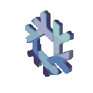
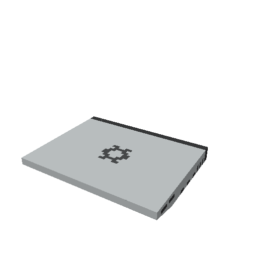

<p align="center">
  
  
</p>

<h1 align="center">sgk-nixos</h1>

<p align="center">
  Nix configuration for my personal NixOS machine, <b>Amakusa</b>,<br>
  a mobile battlestation christened on Aug 10, 2024.
</p>

## Specs

| Component | Hardware |
|-----------|----------|
| Chassis   | Framework Laptop 16 |
| CPU       | AMD Ryzen AI 7 350 |
| iGPU      | AMD Radeon 860M |
| dGPU      | NVIDIA GeForce RTX 5070 Max-Q / Mobile (8 GB) |
| RAM       | 64 GB |
| OS        | NixOS 26.05 (Yarara) |
| DE        | COSMIC 1.0.0 |

## Service History

Amakusa has a planned service life of **10 years** and has been through three refits:

| Refit | Details |
|-------|---------|
| 1st | Repairs after bow damage sustained during operations in Florida (summer 2025) |
| 2nd | GPU upgrade: AMD RX 7700S → NVIDIA RTX 5070 |
| 3rd | Motherboard upgrade: AMD Ryzen 7 7040HS → AMD Ryzen AI 7 350 |

## System Info

```text
╭─sgk @amakusa ~
╰─❯ fastfetch
          ▗▄▄▄       ▗▄▄▄▄    ▄▄▄▖             sgk@amakusa
          ▜███▙       ▜███▙  ▟███▛             -----------
           ▜███▙       ▜███▙▟███▛              OS: NixOS 26.05 (Yarara) x86_64
            ▜███▙       ▜██████▛               Host: Laptop 16 (AMD Ryzen AI 300 Series) (A7)
     ▟█████████████████▙ ▜████▛     ▟▙         Kernel: Linux 6.18.60
    ▟███████████████████▙ ▜███▙    ▟██▙        Uptime: 18 mins
           ▄▄▄▄▖           ▜███▙  ▟███▛        Packages: 14 (flatpak), 3112 (nix-system), 524 (nix-user)
          ▟███▛             ▜██▛ ▟███▛         Shell: bash 5.3.9
         ▟███▛               ▜▛ ▟███▛          Display (BOE0BC9): 2560x1600 @ 1.25x in 16", 165 Hz [Built-in]
▟███████████▛                  ▟██████████▙    DE: COSMIC 1.0.0
▜██████████▛                  ▟███████████▛    WM: cosmic-comp (Wayland)
      ▟███▛ ▟▙               ▟███▛             WM Theme: cosmic-dark - #63D0DF (Dark)
     ▟███▛ ▟██▙             ▟███▛              Icons: Breeze-Noir-White-Blue-V-2 [GTK2/3/4]
    ▟███▛  ▜███▙           ▝▀▀▀▀               Font: Noto Sans (10pt) [GTK2/3/4]
    ▜██▛    ▜███▙ ▜██████████████████▛         Cursor: breeze (24px)
     ▜▛     ▟████▙ ▜████████████████▛          Terminal: cosmic-term 1.11.0
           ▟██████▙         ▜███▙              Terminal Font: Noto Sans Mono (14px)
          ▟███▛▜███▙         ▜███▙             CPU: AMD Ryzen AI 7 350 (8+8) @ 5.09 GHz
         ▟███▛  ▜███▙         ▜███▙            GPU 1: AMD Radeon 860M Graphics [Integrated]
         ▝▀▀▀    ▀▀▀▀▘         ▀▀▀▘            GPU 2: NVIDIA GeForce RTX 5070 Max-Q / Mobile [Discrete]
                                               Memory: 6.94 GiB / 62.10 GiB (11%)
                                               Swap: Disabled
                                               Disk (/): 891.82 GiB / 1.12 TiB (78%) - ext4
                                               Local IP (wlp192s0): 192.168.4.198/22
                                               Battery (FRANDBA): 100% [AC Connected]
                                               Locale: en_US.UTF-8
```

## Commands

**Update/Upgrade NixOS**

```bash
update-sgk-nix
upgrade-sgk-nix
```

**Clean up old generations**

Frees disk space by removing old generations. CUDA-related generations in particular take up a lot of storage.

```bash
nix-collect-garbage -d
```

This README was written on 11/5/26.